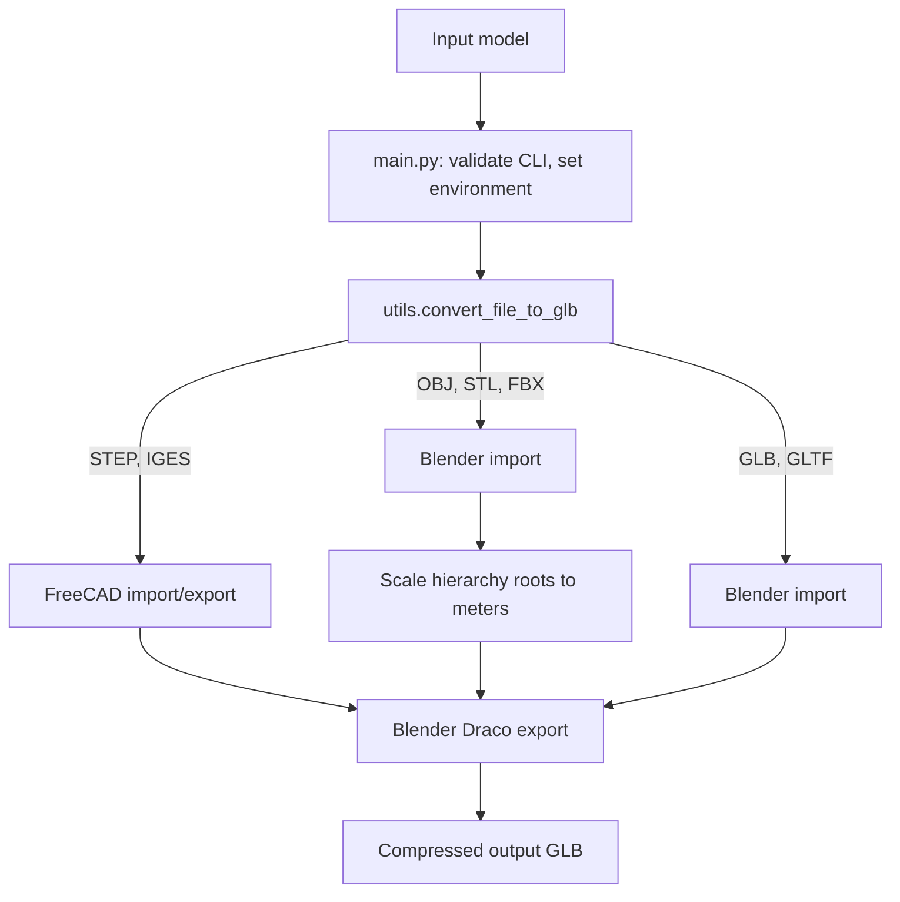

# Architecture

`main.py` validates the command-line arguments, chooses the output path and scale, and calls `utils.convert_file_to_glb`. The dispatcher selects either the Blender-only path or the FreeCAD-plus-Blender path based on the input extension.

## Conversion paths

- **OBJ, STL, FBX:** `convert_non_cad_formats.py` imports the file with Blender, applies the requested scale to hierarchy roots, and exports GLB with Draco compression.
- **GLB, GLTF:** Blender imports and re-exports the model to apply the common Draco settings. Existing coordinates are treated as meters, so the scale argument does not transform these inputs.
- **STEP, IGES:** `convert_cad_formats.py` starts FreeCAD's GUI APIs. `freecad_converter.py` imports and exports the CAD model; Blender then reimports the result and applies scaling and Draco compression.

## Output and environment

`main.py` sets `OUTPUT_PATH` (default `output.glb`) and `MODEL_SCALE`. The CAD path also passes its input through `MODEL_PATH`. The ARDesign Server launches the container with a job working directory and collects the generated output file; see its [worker integration documentation](https://ismayilovh.github.io/ARDesign-Server/architecture/).

## Draco settings

`convert_non_cad_formats.py` uses compression level `6` and quantization `(16, 12, 20, 12)` for position, normal, texture coordinates, and generic attributes. These settings apply to files exported through the shared GLB exporter.
